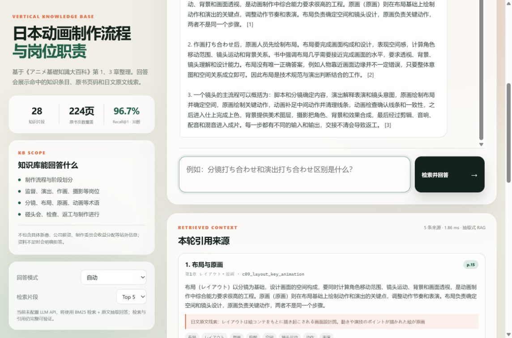

# 日本动画制作流程知识库 RAG

**题 A：动画知识库方向** 的 MVP。项目聚焦一个垂直 topic：

> **日本动画制作流程中的岗位职责与术语辨析**

知识库基于《アニメ基礎知識大百科》第 1 章与第 3 章中与制作流程、岗位职责相关的页面整理，回答会展示命中的知识条目、原书页码和日文原文线索。

系统已经接入 DeepSeek `deepseek-flash` 生成式 LLM，同时保留未注入 API Key 时的抽取式回退模式。



> 截图为未注入 API Key 时的抽取式回退模式；配置 LLM 后可在同一页面切换到生成式 RAG。

## 提交信息

- 公开知识库 URL：待部署后填写
- 公开 GitHub 仓库：待填写
- 本地运行地址：`http://127.0.0.1:8000`
- LLM：已接入 DeepSeek `deepseek-flash`，支持抽取式回退
- 说明：`127.0.0.1` 仅本机可访问，不是公网 URL

## 快速运行

要求：Python 3.10 及以上，无第三方 Python 依赖。

```powershell
cd D:\Study\1\lingtu-rag
python -m rag_app.server
```

打开：

```text
http://127.0.0.1:8000
```

运行测试：

```powershell
python -B -m unittest discover -s tests -v
```

运行检索评测：

```powershell
python -B scripts/evaluate_retrieval.py
```

## 实现方式

```text
用户问题
  ↓
中日文规范化 + 字符 1-4 gram
  ↓
BM25 检索 Top-K 知识条目
  ↓
展示命中来源 / 原书页码 / 日文原文线索
  ↓
抽取式回答（无 Key / LLM 异常时回退）
  或
已接入 DeepSeek LLM：将 Top-K 检索片段放入上下文后生成带引用回答
```

### 为什么使用轻量级自建检索

- 当前知识库只有 28 个高质量人工整理片段，规模很小。
- 主题中的大量关键信号是日文术语，例如 `制作進行`、`絵コンテ`、`レイアウト`、`動画`、`仕上`。
- 字符 n-gram + BM25 对中日文混合查询、短术语和精确匹配都很稳定，且完全可解释。
- 检索层不依赖向量模型或向量数据库，面试官可以直接复现 Recall 评测；生成层已接入 DeepSeek LLM。
- 如果后续把资料扩展到整本 224 页甚至视频字幕，再考虑 embedding + 向量检索 + rerank。

### 已接入的 LLM

当前已接入 DeepSeek `deepseek-flash`，使用 OpenAI-compatible 接口完成生成式 RAG。

- 已实际完成 10 道题（q01～q10）的普通 LLM baseline 与 RAG 对照生成。
- 生成结果保存在 `data/eval/llm_eval_samples.jsonl` 和 `data/eval/answer_review_results.csv`。
- 人工评分列尚未填写，因此 README 不宣称尚未测得的正确率。
- 如果没有注入 API Key，或 LLM 请求失败，系统自动回退到抽取式 RAG。

在运行环境中配置 API 参数：

```powershell
$env:RAG_LLM_BASE_URL = "https://your-provider.example/v1"
$env:RAG_LLM_API_KEY = "your-key"
$env:RAG_LLM_MODEL = "deepseek-flash"
python -m rag_app.server
```

LLM Prompt 要求：

- 只能使用检索资料
- 必须给出 `[1]`、`[2]` 引用
- 资料不足时明确拒答
- 不得补充资料外知识

## 数据收集与预处理

### 原始资料

- 《アニメ基礎知識大百科.pdf》
- 224 页扫描版日文图书
- PDF 没有文本层，`pypdf` 提取到的总字符数为 0

### 实际处理流程

1. 检查 PDF 元数据和文本层，确认是纯图片扫描页。
2. 查看目录，选定第 1 章和第 3 章中与制作流程、岗位职责相关的页面。
3. 逐页阅读原始页面，提取流程、岗位、检查点、会议和术语边界。
4. 以“一个知识点 = 一个可检索 chunk”的方式整理成中文知识条目。
5. 每条保留：
   - 标题
   - 章节
   - 原书页码
   - 中文知识摘要
   - 日文术语和原文线索
   - 检索关键词
6. 对术语做中日文别名扩展，例如：
   - 分镜 → `絵コンテ` / `コンテ`
   - 布局 → `レイアウト`
   - 制作进行 → `制作進行`
   - 动画检查 → `動画チェック` / `動画検査`
   - 返工 → `リテイク`

详细说明见 [data/sources/source_notes.md](data/sources/source_notes.md)。

### 为什么不直接批量 OCR 整本书

- 本机 Tesseract 只有英文模型，无法可靠识别日文假名和动画术语。
- 英文 OCR 会把日文识别成大量乱码，反而污染知识库和评测。
- 任务 A 只要求一个“小 topic”，因此优先选择一个能人工确认质量的窄范围，而不是追求整本 224 页的覆盖率。
- 当前 28 个片段不是全书摘要，也不宣称覆盖整本词典。


## 评测设计

评测分为两层：**检索评测**和**回答质量评测**。

### 1. 检索评测

评测集共 35 题：

- 30 道可回答题，覆盖流程、岗位、会议、术语辨析和细节
- 5 道无答案题，用来测试系统是否会诚实拒答
- 每题标注 `gold_ids`，即正确答案应命中的知识片段

指标：

- Recall@1：正确片段排在第 1 位的比例
- Recall@3 / Recall@5：正确片段进入前 3 / 前 5 的比例
- MRR：正确片段排名的倒数均值
- 无答案识别率：资料不足时是否正确拒答

当前实测结果：

| 指标 | 结果 |
|---|---:|
| 可回答题 | 30 |
| 无答案题 | 5 |
| Recall@1 | 96.7% |
| Recall@3 | 100% |
| Recall@5 | 100% |
| MRR | 0.9833 |
| 无答案识别率 | 100% |

结果文件：

- [data/eval/retrieval_results.json](data/eval/retrieval_results.json)
- [data/eval/retrieval_results.csv](data/eval/retrieval_results.csv)

如果 CSV 正在 Excel/WPS 中打开，脚本会自动写入 `retrieval_results_<时间戳>.csv`，避免评测被文件占用中断。

复现命令：

```powershell
python -B scripts/evaluate_retrieval.py
```

### 2. 普通 LLM 与 RAG 的回答质量评测

设计原则：

- 使用同一个 DeepSeek `deepseek-flash` 模型
- 使用相同或接近的 temperature
- 使用同一套 35 道题
- 普通 LLM 不提供资料
- RAG 使用检索到的 Top-5 片段
- 由人工按统一 Rubric 评分

评分项：

| 评分项 | 0 分 | 3 分 | 5 分 |
|---|---|---|---|
| 答案正确性 | 核心错误 | 部分正确 | 与标准答案一致 |
| 引用忠实性 | 无依据或编造 | 部分有依据 | 关键结论均可被资料支持 |
| 引用质量 | 没有引用 | 有引用但不完整 | 引用准确对应结论 |
| 拒答能力 | 资料不足仍编造 | 拒答含糊 | 明确说明资料不足 |

运行对照实验：

```powershell
$env:RAG_LLM_BASE_URL = "https://your-provider.example/v1"
$env:RAG_LLM_API_KEY = "your-key"
$env:RAG_LLM_MODEL = "deepseek-flash"
python -B scripts/evaluate_llm.py --limit 10
```

脚本会生成：

- `data/eval/llm_eval_samples.jsonl`：每个问题的普通 LLM 回答与 RAG 回答（当前已完成 q01～q10，共 10 题）
- `data/eval/answer_review_results.csv`：运行脚本后生成，包含 baseline / RAG 两种回答和人工评分列
- `data/eval/answer_review_template.csv`：空白评分骨架
- `data/eval/review_guide.md`：每列含义和 0-5 分评分规则

### 当前评测状态

- 检索评测已经真实执行：Recall@1 为 96.7%，Recall@3/5 为 100%。
- DeepSeek `deepseek-flash` 已接入，并完成 q01～q35 的普通 LLM 与 RAG 对照生成。
- `answer_review_results.csv` 中q01~q30均为可回答题；无答案题为q31～q35 。
- 在 35 道题的人工评分中，普通 LLM 的平均得分为2.43/5，RAG 的平均得分为4.73/5，绝对提升2.30分，相对提升约为 94.65%。

## 加分与失败案例分析

### 1. PDF 是扫描版，无法直接抽取文字

- 现象：`pypdf` 对 224 页 PDF 提取到的总字符数为 0。
- 原因：原书是扫描图片，没有文字层；本机 Tesseract 只有英文模型。
- 处理：没有用英文 OCR 强行识别日文，而是把范围收窄到第 1、3 章，逐页阅读后人工整理知识条目。
- 代价：覆盖面变小，但每个片段可回溯、可解释，避免把乱码送进 RAG。
- 后续：安装日文 OCR 模型后，可以批量扩展整本书，再做人工抽检。

### 2. 一个问题的 Top-1 检索失败

- 现象：问题“后期制作包括哪些主要环节？”中，概览片段 `c01_three_stages` 排在第 1，专门的 `c13_postproduction` 排在第 2。
- 原因：概览片段也包含“后期制作包括”等关键词，且描述更宽，BM25 分数略高。
- 处理：没有为了把评测刷到 100% 而针对单题硬编码。该问题在 Top-3 中仍然命中，因此 Recall@3 仍为 100%。
- 反思：真实系统应进一步加入 rerank、标题权重或领域同义词，而不是追逐单条测试集。

## 目录结构

```text
lingtu-rag/
├─ rag_app/
│  ├─ core.py             # 文档加载、分词、BM25、抽取式回答
│  ├─ llm.py              # OpenAI-compatible RAG / baseline 调用
│  ├─ server.py           # HTTP API 与静态文件服务
│  └─ __main__.py
├─ data/
│  ├─ corpus.jsonl        # 28 个知识片段
│  ├─ sources/            # 原始资料处理说明
│  └─ eval/               # 35 题评测集和检索结果
├─ scripts/
│  ├─ evaluate_retrieval.py
│  └─ evaluate_llm.py
├─ static/                # 原生 HTML/CSS/JS 问答页面
├─ tests/                 # 8 个自动化测试
└─ README.md
```

## 时间规划

| 阶段 | 计划耗时 |
|---|---:|
| PDF 检查、目录与章节选择 | 0.5 小时 |
| 原始页面阅读与知识片段整理 | 3 小时 |
| 检索器与回答模式 | 2 小时 |
| Web API 与问答页面 | 2 小时 |
| 评测集与检索实验 | 1.5 小时 |
| 测试、文档与演示 | 3小时 |

## AI coding 使用说明

> 提交前请按你的真实使用记录补全，不要虚构 token 数字。

- 使用的 AI coding 工具： Codex
- token 消耗：41,932,584
- token 消耗最多的部分：知识片段整理、检索器实现、前端页面、评测集
- 未使用 LLM、由个人完成且耗时最多的部分：检查AI给出的结果，人工评分，写README

## 部署

仓库提供了 `render.yaml` 和 `Procfile`，可直接部署到支持 Python Web Service 的平台。

Render 配置：

```text
Build Command: python -m pip install -r requirements.txt
Start Command: python -m rag_app.server --host 0.0.0.0 --port $PORT
```

项目已接入 DeepSeek `deepseek-flash`。部署时通过环境变量注入 LLM 配置即可启用生成式 RAG；如果未配置或请求失败，会自动回退到抽取式模式。

> `--host 0.0.0.0` 只表示监听所有网卡，不会自动获得公网 URL。必须通过 Render、Railway 等平台或服务器反向代理暴露到公网。

